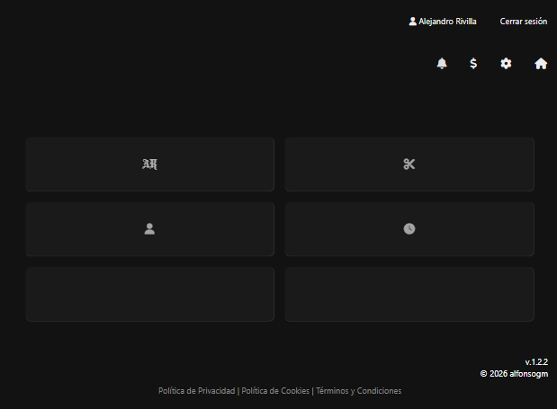
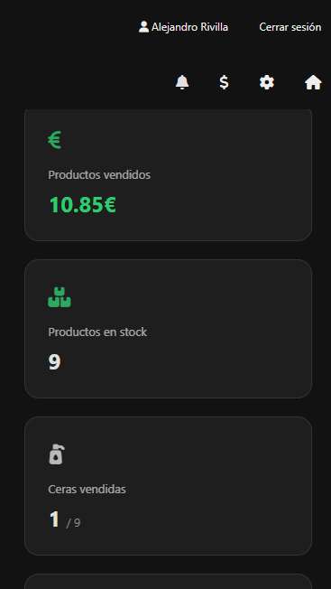
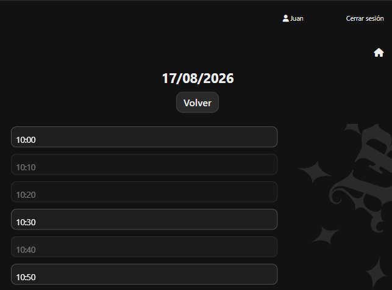
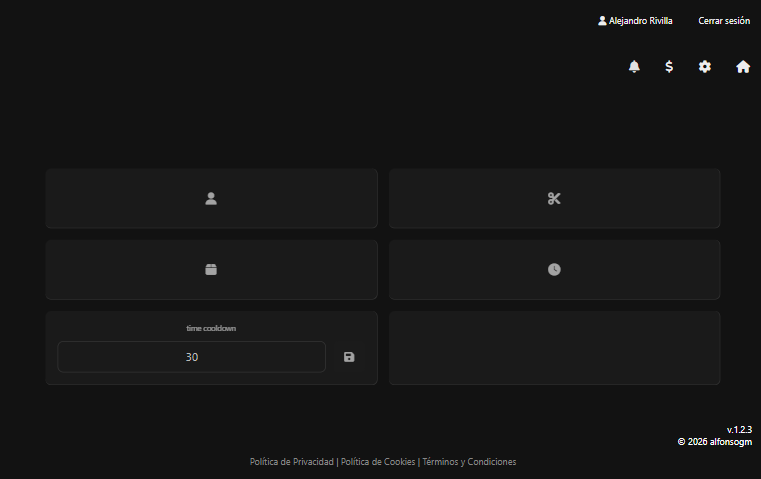

<p align="center">
  
</p>

<p align="center"><sub>v1.2.3</sub></p>

## 📅 Filtro

Se incorpora un nuevo filtro para consultar el resumen de cualquier `mes` y `año`. Hasta ahora únicamente era posible visualizar el resumen correspondiente al mes actual.

<p align="center">
  
</p>

## 📦 Resumen de productos

Se amplía el apartado `Resumen` del Panel de Contabilidad con nuevos indicadores que permiten consultar rápidamente el rendimiento de los productos y stock en inventario.

### Nuevos indicadores

- `Productos vendidos` — importe total obtenido por la venta de productos durante el mes.
- `Productos en stock` — número total de productos disponibles en el inventario.
- `Ceras` — ud. vendidas durante el mes y stock restante (/x).
- `Polvos de cabello` — ud. vendidas durante el mes y stock restante (/x).

<p align="center">
  
</p>

## 🛍️ Productos.php

Se añade un nuevo panel de administración para gestionar el catálogo de productos de la barbería. Este módulo permite mantener el inventario actualizado desde el panel de administración, asentando las bases para su integración con el sistema de ventas.

<p align="center">
  
</p>

### Funcionalidades

- `Añadir`/`Editar`/`Eliminar` productos.
- Clasificación por tipo (`cera`, `polvos de cabello`, `aceite`, `etc.`).
- Gestión del precio de compra y del precio de venta.
- Control de stock y stock mínimo.
- Descripción para cada producto.
- Listado ordenable por ID, nombre, tipo, precio y stock (incorporado en la `v.1.2.2`).

## ⚙️ Panel de configuración

- Se deshabilita la antigua opción `AR` que permitía añadir información a la página principal `/main`.
- Se habilita el nuevo panel de control `productos.php`.

<p align="center">
  &nbsp;&nbsp;&nbsp;
  
</p>

- Además es posible setear el tiempo de cooldown entre citas, solo para el cliente (especificado más adelante). 

## 🛠️ Fix de horarios

Se corrigen diversos errores relacionados con la creación y cambio de `horarios`.

<p align="center">
  
</p>

## ⏱️ Cooldown entre citas

A partir de esta versión, las citas únicamente podrán reservarse respetando el intervalo configurado (30 min por defecto). 

```
10:00
11:30
11:00
11:30
```

De este modo se evita que los clientes puedan reservar horas como 10:10 o 10:20, que podían desorganizar la planificación diaria.

<p align="center">
  
</p>

```
const BOOKING_STEP = window.calendarData.bookingStep || 30;

const inicioJornada = parseHora(horario.hora_inicio);
const esInicioValido =
    ((slotMin - inicioJornada) % BOOKING_STEP) === 0;

if (userType === "cliente" && !esInicioValido) {
    slot.classList.add("disabled-hour");
    return;
}
```

El intervalo entre citas puede configurarse desde el `Panel de Configuración` y su valor predeterminado es de 30 minutos.

<p align="center">
  
</p>

## 📱 Fix vista horizontal

Se ajustan los márgenes en dispositivos con orientación horizontal para evitar que el contenido y los títulos queden ocultos o desplazados.

```
@media (max-height: 583px) and (orientation: landscape){
    body#contabilidad {
        padding-top: 25vh !important;
    }

    body#perfil,
    body#users,
    body#servicios,
    body#productos,
    body#horario {
        padding-top: 27vh !important;
    }
}

@media (max-height: 433px) and (orientation: landscape){
    body#contabilidad {
        padding-top: 30vh !important;
    }

    body#confpan,
    body#perfil,
    body#users,
    body#servicios,
    body#productos,
    body#horario {
        padding-top: 35vh !important;
    }
}

@media (max-height: 375px) and (orientation: landscape){
    body#contabilidad {
        padding-top: 35vh !important;
    }

    body#confpan,
    body#perfil,
    body#users,
    body#horario {
        padding-top: 45vh !important;
    }
}
```