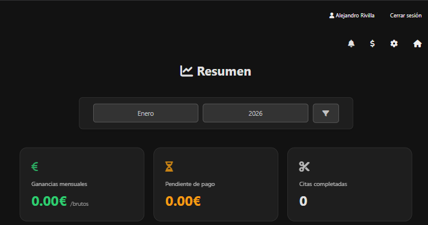
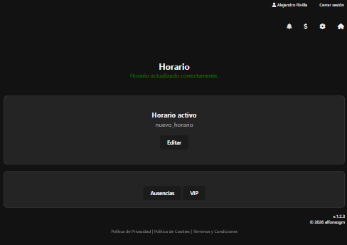

<p align="center">
  
</p>

<p align="center"><sub>v1.2.3</sub></p>

## Filtro

Se incluye un nuevo filtro para revisar el resumen `mes`/`año`. Hasta ahora solo podía revisar el resumen del mes actual.

<p align="center">
  
</p>

## Recuento de productos

Se amplía el apartado `Resumen` del Panel de Contabilidad. Ahora también es posible consultar de un vistazo el rendimiento de los productos destacados y stock disponible.

Se añaden los siguientes indicadores:

- `Productos vendidos` — importe total obtenido por la venta de productos durante el mes.
- `Productos en stock` — número total de productos disponibles en el inventario.
- `Ceras` — ud. vendidas durante el mes y stock restante (/x).
- `Polvos de cabello` — ud. vendidas durante el mes y stock restante (/x).

<p align="center">
  
</p>

## Productos.php

Se incorpora un nuevo panel de administración para gestionar los productos de la barbería. Que permite mantener actualizado el inventario desde el panel de administración, facilitando el control de existencias y posterior integración con el sistema de ventas.

<p align="center">
  
</p>

### Funcionalidades

- `Añadir`/`Editar`/`Eliminar` productos.
- Clasificación por tipo (`cera`, `polvos de bcabello`, `aceite` ...).
- Gestión del precio de compra y del precio de venta.
- Control de stock y stock mínimo.
- Descripción para cada producto.
- Listado ordenable por ID, nombre, tipo, precio y stock (incorporado en la `v.1.2.2`).

## Panel de configuración

- Se ha deshabilitado la antigua opción `AR` que permitía añadir información a la página principal `/main`.
- Se habilita el nuevo panel de control `productos.php`.

<p align="center">
  &nbsp;&nbsp;&nbsp;
  
</p>

## Fix Horario

Se solucionan bugs a la hora de crear un nuevo `horario` y alternar entre los existentes.

<p align="center">
  
</p>

## Cooldown entre horas

A partir de ahora solo se podrán asignar citas en horas `redondas`:

```(10:00, 11:30, 11:00 ...)```

- El cliente antes podía coger cita a las `10:10` / `10:20`, lo que podía descuadrar el día al barbero.

<p align="center">
  
</p>

```
const BOOKING_STEP = window.calendarData.bookingStep || 30;

const inicioJornada = parseHora(horario.hora_inicio);
const esInicioValido =
    ((slotMin - inicioJornada) % BOOKING_STEP) === 0;

if (userType === "cliente" && !esInicioValido) {
    slot.classList.add("disabled-hour");
    return;
}
```

- El tiempo cooldown será asignado desde el panel de configuración. Por defecto es de 30 minutos.

<p align="center">
  
</p>

## Fix Horizontal View

Se solucionan los márgenes en horizontal. Mala impresión / No aparecen los títulos.

```
@media (max-height: 583px) and (orientation: landscape){
    body#contabilidad {
        padding-top: 25vh !important;
    }

    body#perfil,
    body#users,
    body#servicios,
    body#productos,
    body#horario {
        padding-top: 27vh !important;
    }
}

@media (max-height: 433px) and (orientation: landscape){
    body#contabilidad {
        padding-top: 30vh !important;
    }

    body#confpan,
    body#perfil,
    body#users,
    body#servicios,
    body#productos,
    body#horario {
        padding-top: 35vh !important;
    }
}

@media (max-height: 375px) and (orientation: landscape){
    body#contabilidad {
        padding-top: 35vh !important;
    }

    body#confpan,
    body#perfil,
    body#users,
    body#horario {
        padding-top: 45vh !important;
    }
}
```